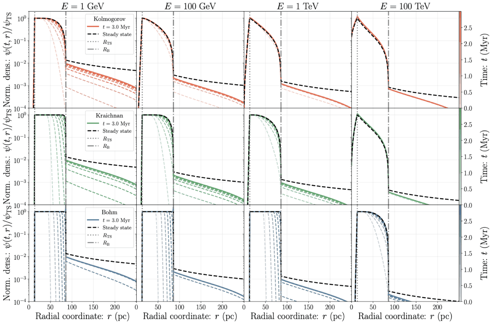

Multi-Energy Diffusion Comparison
=================================

This example demonstrates how to set up and execute an advanced analysis of cosmic ray transport simulation inside a stellar wind bubble using SAETASS. We compare the radial distribution of particles at various energies (from 1 GeV to 100 TeV) and under three different diffusion models (Kolmogorov, Kraichnan and Bohm).

It showcases the initialization of a :py:class:`~saetass.grid.Grid` geometry and a :py:class:`~saetass.state.State` containing physical values. These objects are passed into a :py:class:`~saetass.solver.Solver` which evolves the configuration explicitly according to advective and diffusive operators alongside custom source shapes.

The script executes the necessary propagation computations and compares with the analytical steady-state solution (:cite:ct:`Morlino2021`), outputting a PDF matrix plot.

Workflow Highlights
-----------------------

Here the sections of code of particular relevance are highlighted.

First, the necessary modules are imported from the SAETASS package.

.. literalinclude:: ../../../examples/01_multi_energy_diffusion.py
   :language: python
   :start-after: # 0. Import SAETASS modules
   :end-before: # 0.1 Import end

Then, a parameterization of the specific physical setup we want to simulate is performed. In this example paremeters are defined for a stellar cluster wind bubble using the :py:class:`~saetass.utils.bubble_profiles.BubbleProfileCalculator` class.

.. literalinclude:: ../../../examples/01_multi_energy_diffusion.py
   :language: python
   :start-after: # 1. Generate Physical Setup Parameters
   :end-before: # 2. Create Solver arguments
   :dedent: 4

Once the setup is generated, the :py:class:`~saetass.solver.Solver` arguments are created. To this end, a :class:`~saetass.grid.Grid` object is instantiated to represent our geometry and the mathematical assumptions for the advection, diffusion and source operators are explicitly configured.

.. literalinclude:: ../../../examples/01_multi_energy_diffusion.py
   :language: python
   :start-after: # 2. Create Solver arguments
   :end-before: # 3. Instantiate Solver
   :dedent: 4

With everything prepared, the main :py:class:`~saetass.solver.Solver` is instantiated.

.. literalinclude:: ../../../examples/01_multi_energy_diffusion.py
   :language: python
   :start-after: # 3. Instantiate Solver
   :end-before: # 4. Calculate the time sampling checkpoints to plot curves over time
   :dedent: 4

Finally, the simulation is marched forward in time iteratively using the core :py:meth:`~saetass.solver.Solver.step` method.

.. literalinclude:: ../../../examples/01_multi_energy_diffusion.py
   :language: python
   :start-after: # 5. Simulation loop
   :end-before: # 6. Result Normalization
   :dedent: 4

After having done the simulation for each energy and diffusion model, the results are normalized and compared with the theoretical solutions.

Running the Simulations in Parallel
-----------------------------------

The twelve simulations are independent, so :py:func:`~saetass.sweep.run_sweep` runs them in parallel worker processes and returns their results in order. The function of one simulation must be defined at the top level of the script, where the workers can import it, and the code that calls :py:func:`~saetass.sweep.run_sweep` must be under ``if __name__ == "__main__":``.

.. literalinclude:: ../../../examples/01_multi_energy_diffusion.py
   :language: python
   :start-after: # 8. Run the simulations in parallel worker processes
   :end-before: # 9. Render the data
   :dedent: 4

SAETASS also parallelizes a single simulation, with threads that advance different momenta of its grid, but 1D grids such as those of this example run serially. In general:

* For independent simulations, such as the energies of a 1D problem or a scan of parameters, use :py:func:`~saetass.sweep.run_sweep`: processes scale much better than threads.
* For a single large simulation on a 2D grid, rely on the threads. SAETASS chooses how many from the work of the simulation and the idle cores of the machine.
* To share the machine, for instance with other simulations started by hand, limit the threads of each one with ``SAETASS_MAX_THREADS`` or :py:func:`saetass.parallel.set_max_threads`. ``NUMBA_NUM_THREADS``, set before Python starts, bounds the threads available to every Numba function instead.

See :doc:`/api/performance` for the details.

Complete Script Overview
------------------------

The complete operational script orchestrates these specific steps in a function that the workers run for the different initial energies and diffusion setups, outputting the result graphically.

.. literalinclude:: ../../../examples/01_multi_energy_diffusion.py
   :language: python
   :linenos:

Simulation Output
-----------------

After running the script, the following figure is generated.

